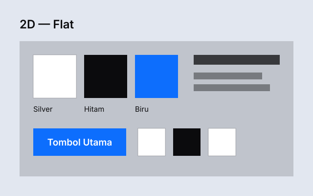
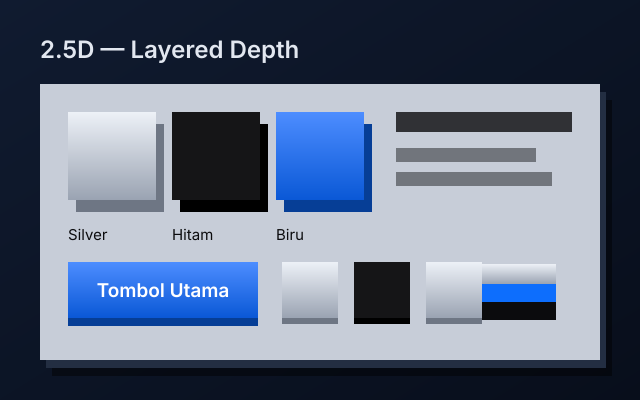
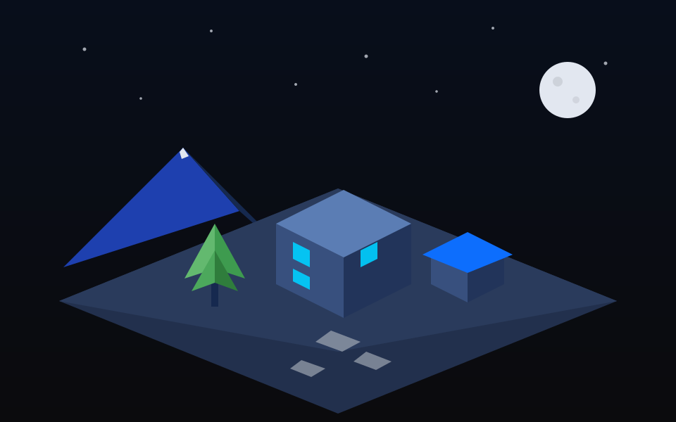

# LAPIS — Design System 2.5D & 3D

Sistem desain milik Erlangga untuk video motion graphics dan UI: gambar berlapis yang terasa punya kedalaman (2.5D) dan set 3D low-poly sederhana. Palet Silver × Hitam × Biru Elektrik, font Space Grotesk + Inter. Sifat wajibnya dua: **hidup** dan **nyaman di mata**.

## Visual Progression

Tiga tahap kedalaman dengan komposisi yang sama:

**2D — datar**

**2.5D — berlapis, bayangan lembut, parallax**

**3D — low-poly, satu cahaya kiri atas**

## Isi repo

- `DESIGN-SYSTEM.md` — dokumen utama: prinsip, warna, sistem kedalaman, geometri, tipografi, komponen, motion, komposisi.
- `tokens/` — design tokens dalam JSON dan CSS.
- `components/COMPONENTS.md` — rincian 10 komponen reusable dan elemen set 3D.
- `SKILL.md` — instruksi untuk AI agent yang memakai sistem ini.
- `examples/` — visual contoh tiga tahap kedalaman.

## Lisensi

MIT — © 2026 Erlangga
